# Brawler

A ROUNDS-style 2–8 player platform shooter: lose a round, pick a card, come back stronger.
Godot 4.7 (.NET / C#), LAN or direct-IP multiplayer, bots, controllers and couch co-op, procedurally generated themed arenas plus a map editor whose arenas share as a short code, and effects that get flashier the more cards you hold.

<p align="center">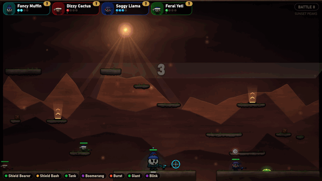</p>

| | |
|---|---|
| 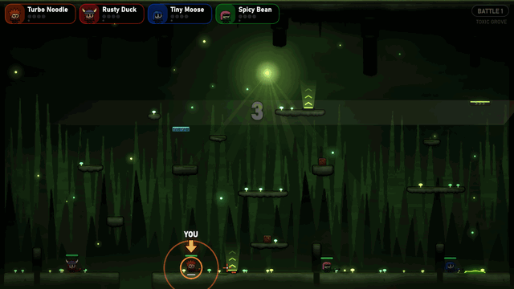 | 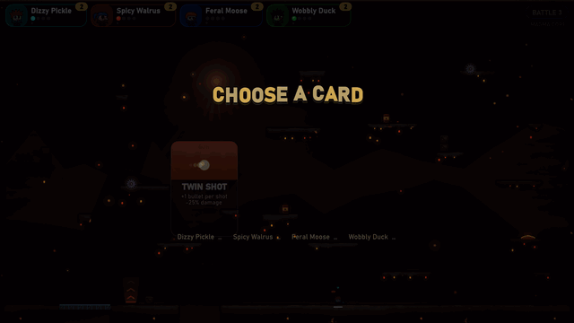 |
| Every battle is on a freshly generated arena, in one of ten themes. Rings and a YOU arrow show where you start. | Lose a round, pick a card. They stack, and your shots get flashier the more you hold. |
| 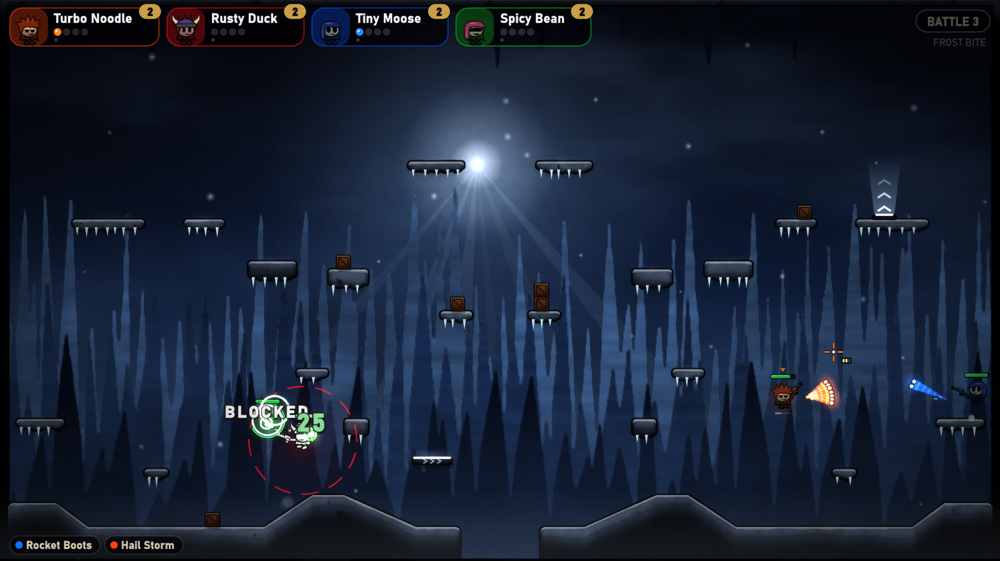 | 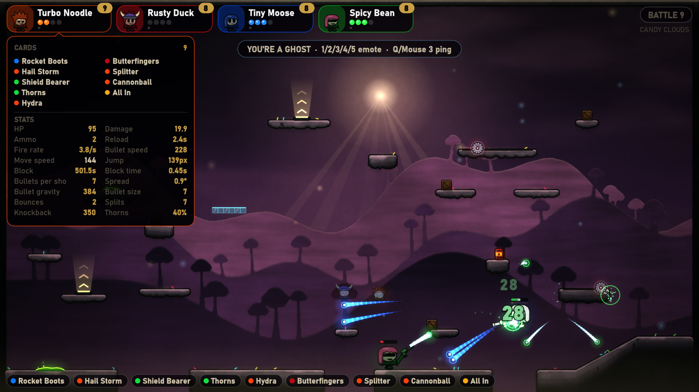 |
| Block to stop a shot. Block cards let you reflect, heal or bash. | Hover any player to see their cards and how they changed their stats. |
| 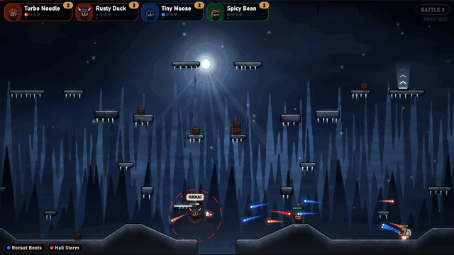 | 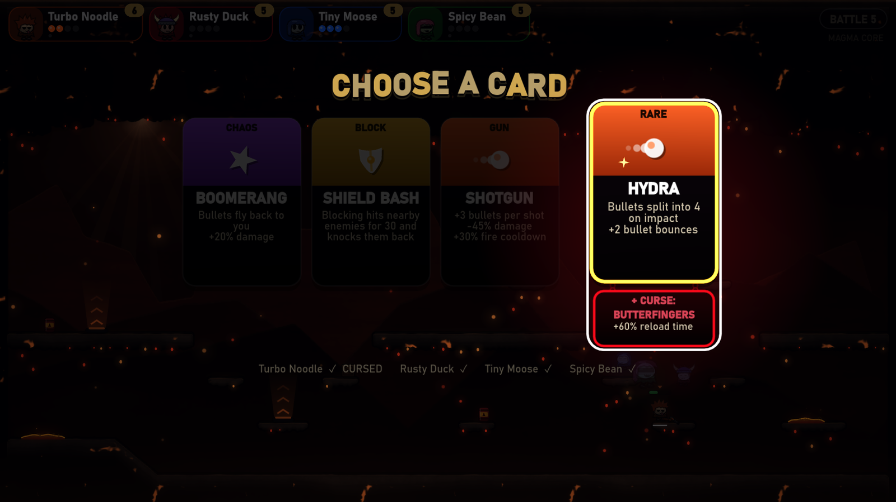 |
| The final kill of every battle replays in slow motion. | Rare cards, and cursed deals that bundle one with a curse. |
| 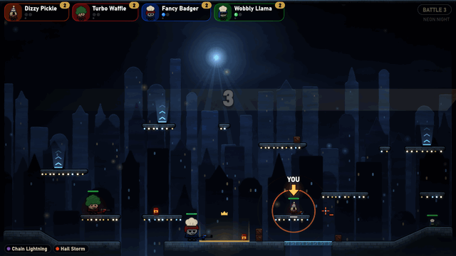 | 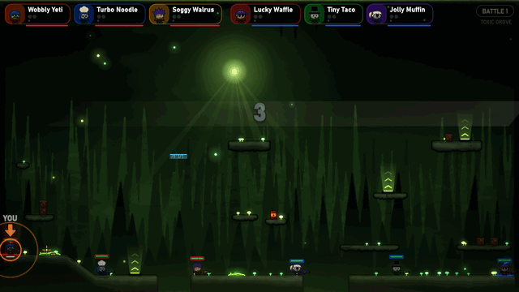 |
| King of the Hill: hold the zone alone to win. | Capture the Flag in 2v2, 3v3 or 4v4. |
| 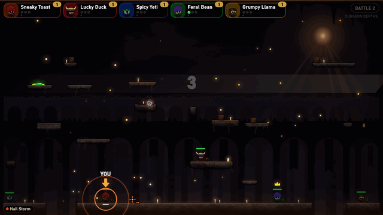 | 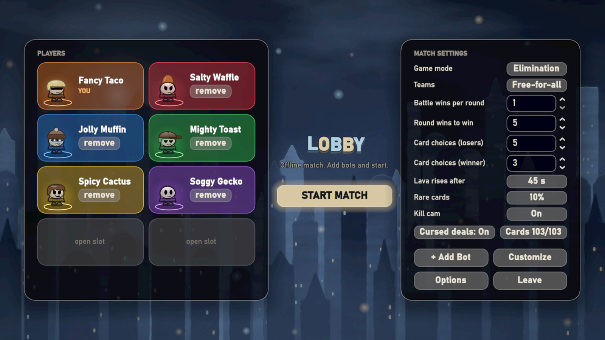 |
| Headhunter: take out the crowned leader to win on the spot. | Up to 8 players, humans and bots in any mix, over LAN or the internet. |
| 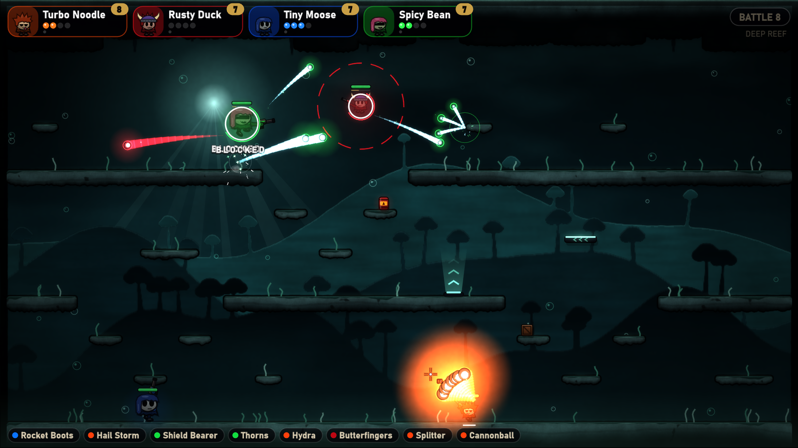 | 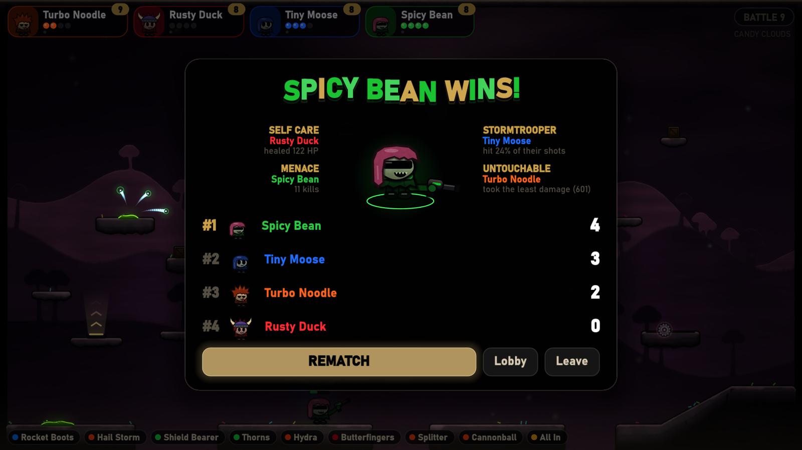 |
| Late in a match, most shots split, bounce or explode. | The first to win enough rounds takes the match, and awards go round. |

<p align="center">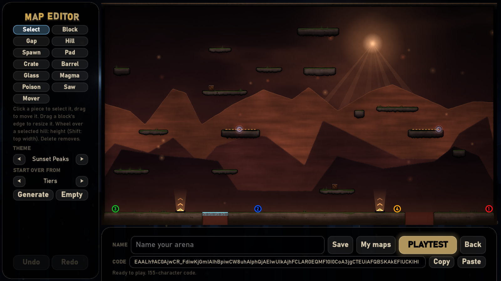<br>
<em>The map editor: start from a generated arena or an empty one, then share it as a map code (see <a href="#map-editor-and-map-codes">Map editor and map codes</a>).</em></p>

## Download and play

**Just want to play?** Grab the zip for your system from the **[Releases](https://github.com/cgsereggela/Brawler/releases/latest)** page, extract it and run it.
You don't need anything else installed. Step-by-step guides:

- **[Install and run](docs/INSTALL.md)**: Windows, macOS and Linux, plus the "unknown publisher" warnings.
- **[Playing online](docs/PLAYING_ONLINE.md)**: friends on different home networks, via Tailscale, automatic port opening or manual port forwarding.

## Run from source

1. Open `godot/project.godot` in **Godot 4.7 .NET** (you already have `Godot_v4.7.2-stable_mono_win64`).
2. Press **Build** (hammer icon) once, then **Run** (F5).

Or from a terminal: `dotnet build godot/Brawler.csproj`, then run the Godot exe with `--path godot`.

### Controls
Defaults; rebind them in Options → Controls.

| Action | Keys |
|---|---|
| Move | A / D (or arrows) |
| Jump / wall jump | W / Space / Up (walk off a ledge and you keep your jump for the whole fall) |
| Aim | Mouse. In a fight the pointer becomes a crosshair in your color: the ring around it is your magazine (one segment per bullet, a gauge plus a number for big magazines) and a yellow arc sweeps round it while you reload. Once you are down it disappears, since your ghost follows the mouse |
| Shoot | Left mouse (hold) |
| Reload | R: reload before the magazine is empty. It reloads by itself only once you run dry |
| Block | Right mouse / Shift |
| Emotes | 1 GG, 2 HAHA!, 3 OOPS, 4 COME AT ME, 5 UNLUCKY: a speech bubble over your head for everyone to see |
| Ping | Q / middle mouse: marks the spot under your cursor for a few seconds |
| Options in a match | Esc (an overlay; the game keeps running) |
| Leave match | Esc → Leave match → Yes |
| Windowed ⇄ full screen | Alt+Enter |

### Controllers and couch co-op
Any controller works too, with a fixed layout (shown in Options → Controls). A controller nobody has claimed drives
you, alongside the keyboard and mouse, and the menus follow the d-pad or left stick with A to choose and B to go back.

| Action | Controller |
|---|---|
| Move | Left stick |
| Aim | Right stick; while it rests, the left stick turns you the way you move. Your crosshair sits on your aim line |
| Jump | A / LB |
| Shoot | RT / RB |
| Block | LT / B |
| Reload | X |
| Emotes / ping | D-pad and Y / right stick click |
| Options | Start |

**Couch co-op:** up to three more people can play on the same computer, each with their own controller. In the lobby
click **+ Local Player** and the new player presses **A** on their pad. They get the next free slot and color, play in
offline, hosted and joined games alike (a client's guests come with it), and pick their cards on the shared screen after
yours ("NAME, CHOOSE A CARD"). Remove one with their *remove* button in the lobby.

Options also has window mode (Windowed / Borderless / Fullscreen) and bloom strength (default 50%). Everything is saved to
`%APPDATA%\Godot\app_userdata\Brawler\settings.cfg`.

### Playing with friends
- **Host:** Menu → *Host Game*. The lobby shows your LAN/VPN address(es) and the port (default `24565`). It also asks
  the router to forward the port via UPnP and, if that works, shows the public `ip:port` with a **Copy** button.
- **Join:** type the host's address (`ip`, `ip:port` or `host:port`) or invite code and click *Join*. The last address is remembered.
- **Streamer mode** (Options → Online): no IP address is shown anywhere. The lobby hides them, *Copy invite* puts a
  code like `J71P-Z4HM-V2T0` on the clipboard instead, and the join box is masked. Friends paste the code where an
  address would go. The code only hides the address from viewers (it can be decoded), so send it privately.
- Players must run the same version (`application/config/version`, shown in the menu); the host rejects mismatches.
- Different home networks: see **[docs/PLAYING_ONLINE.md](docs/PLAYING_ONLINE.md)**.
- **Test alone:** in Godot use *Debug → Customize Run Instances → 2*, host in one window and join `127.0.0.1` in the other.

## Making a release
Players download zips from GitHub Releases. Builds come from Godot's export presets in `godot/export_presets.cfg`
(Windows, Linux, macOS universal, ad-hoc signed), zipped by `tools/package.ps1` together with a `README.txt` made from
`docs/INSTALL.md` + `docs/PLAYING_ONLINE.md`.

**Automatic (GitHub Actions):** push a version tag and `.github/workflows/release.yml` runs the tests, exports all three
platforms on Linux, and publishes a release with the zips (notes from `docs/RELEASE_NOTES.md` plus the commit list).

**Code signing:** `Brawler.exe` (and the game's `Brawler.dll`) are Authenticode-signed with Brawler's own self-signed
certificate, [`docs/brawler-signing.cer`](docs/brawler-signing.cer) (SHA-1 thumbprint
`15E5691329FCBBDD1C1F8F2438471C47FC1E27D9`). Windows doesn't trust a self-signed certificate, so SmartScreen still warns,
but the signature shows the exe is untouched and every release comes from the same key. `tools/new-signing-cert.sh` made
it; the private key lives outside the repo, and the workflow reads it from the `BRAWLER_SIGNING_PFX` (base64 .pfx) and
`BRAWLER_SIGNING_PASSWORD` secrets. Locally, `tools/package.ps1 -SignPfx <pfx>` signs too (password in
`BRAWLER_SIGNING_PASSWORD`).
The tag becomes the game version.
```bash
git tag v0.2.0
git push origin v0.2.0
```
Running the workflow by hand (*Actions → Release → Run workflow*) builds the zips as a downloadable artifact without
publishing a release.

**Local:** needs the Godot .NET editor and its export templates (`-InstallTemplates` downloads them, about 1 GB, once).
```bash
powershell -ExecutionPolicy Bypass -File tools/package.ps1 -Godot "C:/path/to/Godot_v4.7.2-stable_mono_win64_console.exe" -InstallTemplates
```
Output goes to `dist/Brawler-<version>-<platform>.zip`. Pass `-Platforms windows` to build just one and `-Version 0.2.0` to bump the version.
When upgrading Godot, change `GODOT_VERSION` in the workflow and the SDK line in `Brawler.csproj` together.

## Rules
- Up to **8 players**, humans and bots in any mix. With five or more, spawns sit a little closer together (`MapGenerator.SpawnDistance`), the HUD switches to compact player chips, and the match-over standings use two columns.
- **Bot skill**: each bot in the lobby has a skill button that the host clicks through **Easy**, **Normal** and **Hard** (new bots get the last one picked). Easy bots aim loosely, wait a moment before firing, shoot from closer, rarely block and keep their distance. Hard bots lead their shots fully, aim tight, shoot from further off and block nearly every bullet they see coming. Normal is the bot as before, and the card balance stats record each bot's skill. The numbers are in `godot/scripts/Logic/BotSkill.cs`.
- A **battle** ends when one player is left standing (in the default Elimination mode; see Game modes below). Win *N battles* to take a **round**, and win *M rounds* to take the **match**. Both numbers are set in the lobby. As each battle starts, rings close in on your character and an arrow marked YOU points at it through the countdown, so you can find yourself at once.
- **Team modes**: the lobby's **Teams** button steps through Free-for-all, 2v2, 3v3 and 4v4. Players are dealt onto Red and Blue, and the lobby shows a column per team; click your team tag to switch sides (the host can move anyone, bots included). Teams can be uneven but not over the size, and both need someone. The last team with anyone standing wins the battle, and the whole team scores and gets the winner's card choices together. Teams spawn on opposite sides, swapping each battle. Teammates wear a team-colored frame around their HP bar and are grouped on the HUD. With **Friendly fire** off (the default) your shots, blasts, bashes and chain arcs pass harmlessly through teammates; turn it on and they hurt. Bots never target teammates. Team matches stay out of the card win rates (see Card balance stats). The rules are in `godot/scripts/Logic/Teams.cs`.
- **Game modes**: the lobby's **Game mode** button picks what wins a battle. **Elimination** (the default) is last one standing. **King of the Hill**: a glowing zone sits on a platform near the middle; hold it alone (anyone else in it contests it) for 10 seconds in total to win the battle. Bars over the zone show everyone's held time, and it never drains. **Capture the Flag** (team modes only; picking it in free-for-all switches to 2v2): each team's flag sits at its base. Touch the enemy flag to take it, and bring it to your own base while your flag is there to win the battle. A carrier who goes down drops the flag where they fell; a defender touching it sends it home, as does lying there 12 seconds or falling into a pit. **Headhunter**: elimination, but the match leader (most rounds, then battles; ties broken at random) wears a crown, and whoever takes them out wins the battle on the spot. Everyone, bots included, goes after the head. In King of the Hill and Capture the Flag the fallen **respawn** after 3 seconds, on their own side in team modes, with a moment of protection. Sudden death comes twice as late there, and once the lava starts nobody respawns, so a stalled battle still ends. Bots head for the hill and the flags. Only elimination matches go into the card win rates. The rules are in `godot/scripts/Logic/GameModes.cs`.
- After every round, **everyone picks a card**. Losers choose from more options (default 5) than the winner (default 3, or 0 to skip).
- The host picks which cards can come up: **Cards** in the lobby opens the card pool, where cards can be switched off one by one or per category (at least 7 stay in). Everyone else can open it to see the pool. The host's choice is saved in the `[cards]` section of `settings.cfg`.
- **Rising lava** (sudden death): once a battle has run 45 seconds, a warning counts down from 5 and then lava wells up from the bottom of the arena. It climbs slowly at first and then faster, covering the floor in about 3 seconds and the whole arena in about 23. Lava burns 60 damage/s and pops you upward so you can climb out; it also swallows crates, barrels and glass. Set *Lava rises after* in the lobby (20, 30, 45, 60 or 90 s, or Never). Bots climb away from it. The numbers are in `godot/scripts/Logic/RisingLava.cs`.
- Each battle gets a newly generated arena.
- **Kill cam**: when a battle ends, the final kill plays again in slow motion. The camera closes in on the victim and the killer, and the shots, hits and effects replay as they happened, with the build-up near full speed and the hit itself at 0.3x. It takes about 3.5 seconds. Press shoot or jump to skip; it ends early once every human player has. The host can turn it off in the lobby (**Kill cam**). Each player's game records the last few seconds of the battle as they saw it and replays that, so nothing extra goes over the network. The timing is in `godot/scripts/Logic/KillCamTiming.cs`.
- When you die you rise as a **ghost** until the next battle. It floats after your cursor, straight through walls, and can't touch anything, but you can still emote (a ghost says *BOO!*, *AVENGE ME!* and *SO UNLUCKY* instead of *HAHA!*, *COME AT ME* and *UNLUCKY*) and ping to point out where things are. Bot ghosts haunt the nearest player, and bots sometimes emote when they score a kill, die or win. Emotes and pings are limited to a burst of three, then one every 1.5 seconds; the host enforces this. The list is in `godot/scripts/Logic/Emotes.cs`.
- The match-over screen hands out up to four **awards** beside the champion, such as *Own Worst Enemy* (most self-inflicted exits), *Frequent Flyer* (longest time in the air), *Brick Wall* and *Stormtrooper*. Everyone gets one before anyone gets a second, and a tie gives nobody the title. The list is in `godot/scripts/Logic/Awards.cs`.
- When the match ends, the standings show each player's round wins; hover a player chip at the top to see their cards and stats over the screen. Press **Rematch** to go again with the same players and settings, from zero cards. It starts once every player still there has pressed it (bots always agree); press it again to take your vote back. The host can also take everyone back to the **Lobby** instead.

## Cards
There are 103 cards: 81 common cards in five categories, 10 rare cards and 12 curses. Strong cards come with a tradeoff (less damage, HP, ammo, speed, ...). The full list with exact numbers is in `godot/scripts/Logic/Cards.cs`.
- **Gun** (orange): more, bigger, faster or slower bullets. For example Sniper, Minigun, Twin Shot, Hail Storm, Cannonball, Needles, Ricochet, plus the originals (Bouncy, Big Bullet, Pierce, Splitter, Homing, Explosive, Shotgun, Burst, ...).
- **Body** (green): size and toughness. Giant (huge, tanky, very slow), Tiny (small, fast, fragile), Armor Plating, Regeneration, Anchor, Rubber Body, Juggernaut, Second Wind (one revive per battle), Thorns, Adrenaline, ...
- **Movement** (blue): Double Jump, Cloud Walker, Spring Legs, Rocket Boots, Sprinter, Afterburner, Traction, Ice Skates, Glider (hold jump), Wall Runner, Parkour, Dash (on block), Jetpack (jump in mid-air and hold), Feather, Speedy.
- **Chaos** (purple): cards that change how you play. Bullet Hell (a ring of 12 bullets), Upside Down (bullets fall up), Boomerang, Ghost Rounds (through walls), Kamikaze, Recoil Jet (shooting propels you), Warp Rounds (teleport to where your bullets land), Sticky Mines, Chain Lightning, Berserk, One Shot, Wild Rounds, Pinball (you bounce off surfaces), Mind Control (bullets follow your crosshair), Leech Field, plus Vampire, Blink and Glass Cannon.
- **Block** (gold): cards that change what your block does, or trade it away. Reflector (blocked bullets fly back at the shooter), Shield Bash (blocking slams enemies next to you), Shockwave (blocking erases nearby enemy bullets), Spiked Shield, Absorb (blocked hits heal you), Riposte (bonus damage after a block), Reactive Reload, Momentum (blocked hits refund cooldown), Bulwark, Quick Guard, plus Iron Will and All In, which give up blocking for HP or damage.

### Rare cards and cursed deals
- **Rare cards** have a gold frame and a RARE label. They are build-defining and mostly free of tradeoffs: Arsenal, Seeker Warheads (homing explosive bullets), Hydra, Overclock, Titan, Phoenix (two revives per battle), Skywalker, Storm Caller, Vampire Lord and Mirror Guard. Rares come up only now and then: each pick has a chance to include one rare card, which the host sets in the lobby (**Rare cards**: Off, 5%, 10% (default), 20% or 35%). Off means no rares at all, deals included.
- **Cursed deals**: with **Cursed deals: On** (the default), a pick can also offer one deal, as often as the rare chance (so 10% of picks by default), set apart on the right: a rare card with a **curse** chained under it. Take it and you get both. Curses (red) are pure downsides such as Brittle (-25% HP), Lead Boots, Butterfingers, Glass Jaw (take 20% more damage), Big Target or Short Fuse; they are never offered on their own. Bots take the deal now and then.
- **Draft**: with **Draft: On** in the lobby, the match opens with a draft instead of empty hands. The host rolls one shared pool of cards (everyone's picks plus two spare, at most 10), and players take turns taking one, in a shuffled order that snakes back (1, 2, 3, then 3, 2, 1). With up to four players everyone drafts two cards, with five or more one. Everyone sees the pool and who is drafting; a turn lasts 15 seconds. Drafted cards stay out of the card pick stats. The rules are in `godot/scripts/Logic/Draft.cs`.
- Rare cards and curses can be switched off in the card pool like any other card; they don't count toward the 7 cards that must stay in.

### Combos
Some card pairs unlock a bonus on top of both cards: hold one card from each side and the combo switches on. A card in a pick that would complete one has a gold **COMBO** tag (hover it to see what it unlocks), taking it shows **COMBO FOUND!**, and the combos you hold sit in gold at the front of your card strip, in the scoreboard hover card and on the match-over screen. Bots usually take a combo card when one is offered. The list is in `godot/scripts/Logic/Combos.cs`:

| Combo | Cards | Bonus |
|---|---|---|
| Bounce Bombs | Bouncy or Ricochet + Explosive | bullets explode (smaller) on every bounce |
| Minefield | Sticky Mines + Explosive | mines last 3 s longer, +30% explosion size |
| Blood Pact | Vampire + Leech Field | +15% lifesteal, +15 HP/s leech |
| Deadeye | Sniper + Marksman or High Velocity | +1 pierce, +20% damage |
| Moon Boots | Double Jump, Cloud Walker or Parkour + Feather or Rocket Boots | +1 mid-air jump |
| Lead Storm | Shotgun or Hail Storm + Burst | -20% fire cooldown |
| Seeker Swarm | Homing or Mind Control + Splitter | stronger homing |
| Mirror Wall | Reflector + Spiked Shield or Bulwark | +50% block duration |
| Rampage | Berserk + Adrenaline | +15% move speed, +15% lifesteal |
| Returning Blade | Boomerang + Pierce | +1 pierce, +20% damage |
| Troll Blood | Tank or Giant + Regeneration | +5 HP/s regen |
| Iron Curtain | Quick Guard + Momentum | -20% block cooldown |

## Arenas
- The arena is 1000×562 (`MapLayout.Width/Height`). Each battle's seed picks a **layout style**:
  - *Tiers*: scattered platforms with the odd pillar.
  - *Mirror*: a symmetric layout.
  - *Islands*: floating islands over deadly pits.
  - *Towers*: solid towers rising from the floor, climbed by zigzag ledges.
- About 40% of arenas get **floor terrain** (`godot/scripts/Logic/Terrain.cs`): hills up to 64 px tall, stepped hills, mesas and shelves against the side walls, with valleys between them. Ramps are at most 40° (under the 45° walkable limit) and you can run up them; bullets bounce off them at the real angle. Mirror arenas mirror their terrain.
- The floor is a thick band (`MapGenerator.FloorDepth`, 32 px) along the bottom of the screen. Your cards are listed inside it, so they never cover the fight.
- Stacked platforms always leave at least 50 px of clear air (`MapGenerator.MinClearance`), enough for a Giant to walk under.
- **Jump pads** (glowing plates with rising chevrons) launch you about 215 px up. Maps never rely on them to connect spawns.
- **Arena features**, also seeded (`godot/scripts/Logic/ArenaFeatures.cs`). Like pads, maps never rely on them to connect spawns, and they always stay clear of spawns:
  - *Crates* (60 HP): walk into one to push it; you can stand on them and knock them into pits. Some are stacked two high.
  - *Explosive barrels* (30 HP): pushable, and they blow up when destroyed. The blast sets off other barrels nearby.
  - *Glass*: bridges across pits and floating panes. A bullet that breaks a tile flies on through, so you can shoot the floor out from under someone.
  - *Moving platforms* glide back and forth over pits or through open air and carry whoever is standing on them.
  - *Magma pools* burn (45 damage/s) while you stand in them. *Poison pools* hurt less (16/s) but keep working for 2 s after you step out.
  - *Sawblades* slide along platform tops. Each hit deals 22 damage and throws you clear. They also chew up crates and barrels.
  - Which hazards appear, and how often, depends on the theme (one table in `godot/scripts/Logic/ThemeRules.cs`): no sawblades or magma on Deep Reef, no magma on Toxic Grove, no poison on Magma Core, no pools at all on Frost Bite.
  - Blocking stops hazard damage too. A hazard or pit kill is credited to whoever hit the victim in the last 4 seconds.
- **Movement:** you run at 144 px/s and a jump rises about 82 px. Gravity is gentle and you can still jump for 0.2 s after walking off a ledge, so a missed step can be saved mid-air.
- The seed also picks one of ten **themes** (Neon Night, Sunset Peaks, Deep Reef, Toxic Grove, Magma Core, Frost Bite, Candy Clouds, Dungeon Depths, Elder Forest, Mainframe). Each theme sets the sky, the silhouettes (city towers, mountains, hills, thorns, vaulted arches, pine forest, circuit boards), drifting motes (bokeh, embers, bubbles, snow, fireflies, falling leaves, data bits), platform colors and decorations (string lights, grass, seaweed, mushrooms, lava drips, icicles, sprinkles, candles and chains, ferns and vines, status LEDs). Themes are cosmetic and identical on every peer.

### Map editor and map codes
**Map Editor** on the main menu builds your own arenas:
- **Start from** a generated arena in any layout style and theme (**Generate**, again for another), or from an empty one.
- **Tools** (hotkeys in the tooltips):
  - Shapes: blocks, floor gaps, hills with walkable ramps.
  - Placed pieces: spawns, jump pads, crates, barrels, glass rows, magma and poison pools, sawblades, moving platforms.
  - Snapping: everything snaps to the 8 px grid. Spawns, pads, crates and pools drop onto the ground below them.
- **Editing:**
  - Select drags pieces around; moving a block carries whatever stands on it. Drag a block's edge to resize it, and use the mouse wheel over a selected hill to change its height.
  - Right-click deletes, Ctrl+Z / Ctrl+Y undo and redo, Ctrl+D duplicates.
  - On a controller: the left stick moves a cursor (the d-pad nudges it a grid step), A places (hold to drag), B deletes, LB/RB change tools, X/Y undo and redo, and View switches to the buttons (Save, Playtest, Back).
  - The status line names anything that would play badly, such as a spawn standing on nothing or one spawn that can't reach another.
- **Missing spawns:** an arena needs no spawns. Any missing ones are picked on ground everyone can reach, as far apart as fit.
- **Saving and sharing:**
  - **Save** keeps the arena in `user://maps` as a `.map` text file holding its code. **My maps** lists them with a thumbnail of each.
  - Every arena has a **map code**: one line of text (`godot/scripts/Logic/MapCode.cs`), about 200 characters for a busy generated arena and a few dozen for a simple one. **Copy** and **Paste** share it.
  - **Playtest** plays the arena against a bot at once.
- **In a lobby:** the host clicks **Arenas** to tick saved arenas or paste a friend's code. Ticked arenas take turns, one per battle. With none ticked, every battle gets a generated arena as before. Every arena listed there has a thumbnail and **Copy** for its code, and other players can **Save** the host's arenas. Mid-match, the Esc overlay offers **Save arena** and **Copy code** for the custom arena being played.
- **How it plays:** a design (`MapDesign`) builds the same `MapLayout` the generator makes, so collision, drawing, bots and every game mode work on it unchanged.

## Effects that grow with your cards
Every card you hold makes your shots, hits and kills flashier. Your **power** is your card count, and it maps to tiers 0–5:
- *More cards:* longer, brighter bullet trails; more sparks and debris; bigger shockwave rings; light rays and confetti on kills; screen flashes and a camera punch at high tiers; louder kill words ("KO!" up to "VAPORIZED!!"); longer hit-stop.
- *Flavors from specific cards:*
  - Explosive: embers and smoke.
  - Homing: sparkles.
  - Vampire: red motes that fly back to you.
  - Glass Cannon: glass shards.
  - Splitter: colored shards.
  - Bouncy: ring cascades.
  - Pierce: slash streaks.
  - Feather: drifting feathers.
  - Chain Lightning: crackling sparks and lightning bolts.
  - Ghost Rounds: shimmering, see-through bullets.
- *Streaks:* kills in the same battle call out DOUBLE KILL, TRIPLE KILL and RAMPAGE.
- *Pit kills:* knocking someone into a pit credits the last player who hit them (for the effects only, not the stats).

Everything is computed from the card list every peer already has, so nothing extra goes over the network. The mapping lives in `godot/scripts/Game/FxStyle.cs`.

## Characters
- **Customize Character** (in the menu or lobby) opens the editor: body color, eyes, mouth, hair, hair color, hat and hat color, plus *Randomize*. The preview follows your mouse.
- Your name, color and look are saved to `%APPDATA%\Godot\app_userdata\Brawler\profile.cfg` and sent to everyone in the lobby. Bots get a random look.
- Looks are cosmetic only. A hat is drawn above the hitbox and never takes a hit.
- Characters hold the gun out at arm's length, and it swings around the front of the body as they aim, so it never covers the face. Bullets leave from the drawn muzzle: the arm and gun geometry lives in `godot/scripts/Logic/GunRig.cs`, shared by the art and the host's bullet origin, and the unit tests sweep every aim to check the gun stays clear of every face option.

## Look and feel
- **Rendering:** the game renders at the window's resolution (base 1000×562, the arena's size, `canvas_items` stretch) with 4× MSAA. All art is smooth vector shapes drawn in code, and there are no image files.
- **Glow:** HDR 2D plus a `WorldEnvironment` glow make anything drawn brighter than 1.0 bloom: bullets, neon edges, muzzle flashes and effects. Use `Shapes.Hdr(color, boost)` to make something glow.
- **Text:** a system sans font (Bahnschrift on Windows, with fallbacks) through `Fonts.Regular/Bold/Heavy`.
- **UI:** a glass-panel theme in `UiKit`, with hover bounce on buttons. `TitleText` draws the big animated headings.

## Project layout
```
godot/
  scenes/Main.tscn          the only scene; everything else is built in code
  scripts/Main.cs           wiring and screens; Main.CommandLine/.Checks/.Shots: the automated test, screenshot and benchmark modes
  scripts/Logic/            engine-independent rules (unit-tested): Rng, Stats, Cards, MapGen, MapDesign + MapCode (custom arenas), ArenaFeatures, Sweep, Appearance, GunRig,
                            Teams, GameModes (hill, flags, head), StatsModel/StatsReport, Synth (sound and music)
  scripts/Core/Shared.cs    lobby/settings/input types + binary wire format; Profile.cs saves the local look; MapLibrary.cs saved arenas
  scripts/Net/              NetworkManager (ENet host/join, lobby sync, version check), PortOpener (UPnP)
  scripts/Game/             GameManager (state and simulation; .Flow: match flow, kill cam, picks; .Combat: damage and hit/kill effects; .Modes: respawns and objectives; .Chat: emotes and pings; .Sync: snapshots and wire formats), ObjectiveNode (draws them), Avatar, AvatarArt (character + gun vector art),
                            BulletSystem, BotBrain, CardEffects, MapNode (platforms, pads, decorations), Arena (crates, glass,
                            movers, pools, saws), KillCam (records the battle, replays the final kill), Backdrop (scenery),
                            ArenaTheme, FxStyle (card-driven effect power and flavors)
  scripts/Fx/               FxLayer (particles, rings, rays, flashes, popups, drawn in batches by TriBatch and kept to a
                            frame-time budget by Logic/FxBudget), Visuals (shapes, glow texture, fonts), IconMaker, synthesized SFX
  scripts/UI/               menu, lobby (ArenaPoolUI picks its arenas), character editor, map editor, HUD, crosshair (ammo + reload),
                            card pick, match over
tests/                      console test runner for scripts/Logic (dotnet run)
tools/CardStats/            card balance report from the stats log (dotnet run)
tools/package.ps1           export + zip release builds (see Making a release)
docs/                       player guides (INSTALL, PLAYING_ONLINE), release notes, card stats
```

### Netcode in one paragraph
The host is authoritative. Clients send one `InputFrame` per physics tick, and the host simulates every avatar, resolves hits and broadcasts a 60 Hz snapshot. Each client predicts its own movement and snaps back only if it drifts more than 24 px. Bullets are sent as **spawn events**: every peer simulates them locally, but only the host decides hits, splits and explosions. Each arena is rebuilt from a **seed**, so a map costs 4 bytes on the wire; custom arenas travel once, packed, in the lobby settings, and the seed says whose turn it is.

## Adding a card
**Without the source code:** drop a JSON card file into the `cards` folder next to your settings (`%APPDATA%\Godot\app_userdata\Brawler\cards` on Windows). Custom cards use ids 1000 and up, and in multiplayer everyone plays with the host's custom cards. The format, every stat name and examples are in [docs/CUSTOM_CARDS.md](docs/CUSTOM_CARDS.md); the release zips include it in a `custom-cards` folder.

**Built in, from source:**
1. Add a line to `CardRegistry` in `godot/scripts/Logic/Cards.cs`:
   ```csharp
   Add(82, "Longshot", "+80% bullet speed\n+30% damage\n+50% fire cooldown", CardCategory.Gun,
       M(Stat.BulletSpeed, 1.8f), M(Stat.Damage, 1.3f), M(Stat.FireCooldown, 1.5f));
   ```
   `A(...)` adds and `M(...)` multiplies. Adds always apply before multipliers, so pick order doesn't matter.
2. If the card needs behavior beyond stats, give it an effect id (as `"blink"` does), implement `ICardEffect` in `godot/scripts/Game/CardEffects.cs`, and register it in `CardEffects.Create`.
3. If it needs a new number, add it to the `Stat` enum (and `StatBlock.Base()` if it is not 0) in `Stats.cs`, then read it where it applies. Bullet behaviors that every peer must simulate the same way go on `Bullet` and its wire format in `BulletSystem.cs`; host-only rules (damage, revives, chain hits) go in `GameManager.HostDamage` and friends.
4. Never reuse or renumber an id: the stats log refers to cards by id.
5. Optional: give it an effect flavor in `CardFlavors` in `godot/scripts/Game/FxStyle.cs`. Every card adds power on its own, flavored or not.

## Adding a face part, hairstyle or hat
Character art is vector shapes drawn in code, so there are no image files to manage.
1. Add the option name to the end of its list in `godot/scripts/Logic/Appearance.cs` (`EyeNames`, `MouthNames`, `HairNames`, `HatNames` or `Dyes`). Saved profiles store indices, so append; don't reorder.
2. Add a `case` with the same index to the matching `Draw…` method in `godot/scripts/Game/AvatarArt.cs` (`DrawEyes`, `DrawMouth`, `DrawHair`, `DrawHat`).
   - Shapes come from `Shapes` (`Ellipse`, `RoundRect`, `Capsule`, `Star`, or a point list). Draw them with `Shapes.Fill(ci, points, fill, outline, width)`.
   - Use `c.Hair` / `c.Hat` for dye colors, and wrap colors in `c.H(...)` so they flash white when hit.
   - For hair and hats, also add the shape's top y to `HairTop` / `HatTop`, so the HP bar clears it.
3. Check the result with `--menushots` (see Tests). It saves a gallery page for every part.

Sprite space faces right with the hitbox centered on (0,0): x −7..7, y −9..9 (14×18). The round body fills y −9.5..3.4 and two short legs reach down to the soles on y = 9. Face parts, hair and hats are drawn on the body, which bobs as a whole (`AvatarArt.BodyOffset`), so keep new parts above y ≈ 3.
The legs are animated from what every peer already has (position, velocity, level geometry via `Logic/Footing.cs`): a walk cycle driven by horizontal speed, an idle breath, rise/apex/fall poses, a wall slide, a landing squash, and feet that reach down to ramps. It is cosmetic only. The gun is built from `GunLook` parameters (receiver, barrel, magazine, scope, stock). Card-specific guns can be added later by giving each avatar a different `GunLook`.

## Adding an arena theme
Add an `ArenaTheme` to `ArenaTheme.All` in `godot/scripts/Game/ArenaTheme.cs`. It sets three sky colors, the platform and edge colors, a skyline (`City`, `Mountains`, `Hills`, `Spires`), motes and a decoration. A new `Deco` or `Motes` kind needs a case in `MapNode.DrawDeco` or `Backdrop.DrawMotes`. Adding a theme changes which theme existing seeds get, which is fine because themes are cosmetic.

## Card balance stats
The host records every match to a log so card balance can be tuned from data instead of feel. Full details, including the log schema, metric formulas and how to extend it, are in [docs/card-stats.md](docs/card-stats.md).
- **Where:** `%APPDATA%\Godot\app_userdata\Brawler\stats\card_stats.jsonl`. Each line is one match in JSON. Change the folder with `--statsdir=PATH`.
- **What:** for every battle it stores each player's cards (stacks included), the fight length, the winner, shots, hits, damage dealt, taken, self-inflicted and healed, blocks, kills, and when and how each player died. For every card pick it stores what was offered, what was picked, who picked it (human or bot, round winner or not), how long the decision took, and what that player already held. Each record is tagged with its mode (`offline`, `host` or `sim`) and a hash of the card table, so changing a card's numbers starts a fresh balance version.
- Only the host records. A match you leave early is still saved, flagged `complete: false`. Automated tests don't record unless you pass `--stats`.

**Generate data with bots.** A 4-player match takes about 5 seconds headless:
```bash
GODOT=".../Godot_v4.7.2-stable_mono_win64_console.exe"
"$GODOT" --headless --path godot --fixed-fps 60 -- --simulate=200            # 2–8 players per match
"$GODOT" --headless --path godot --fixed-fps 60 -- --simulate=200 --players=4
```

**Read the report.** It gives win ratio, match win ratio, win time, damage, kills, survival, accuracy, pick ratio, stacking and pair synergies:
```bash
cd tools/CardStats && dotnet run                      # markdown report to the console
dotnet run -- --out=report.md --csv=out               # save the report plus cards.csv and pairs.csv for a spreadsheet
dotnet run -- --humans                                # only human players (what real play looks like)
dotnet run -- --mode=sim --cards=all --min=50         # filter by mode, include old card versions, raise the sample threshold
```
How to read it:
- **Win ratio** is wins divided by a fair share, where the fair share is 1/players per battle. 1.00 means balanced. The ± is a 95% interval, and the verdict flags a card only when that interval is clearly off 1.0.
- **Pick ratio** is picked divided by random choice. Bots pick at random, so use the *Human pick* column to see what players actually like.
- **Synergy** is a pair's win ratio minus what the two cards would predict on their own. Positive means the combo is stronger than its parts.
- Bot data shows raw power. Human data shows power once players aim and pick on purpose. Compare the two.

## Tests
```bash
cd tests && dotnet run
```
Covers RNG determinism, stat stacking order, card registry (12+ cards per category, every card keeps core stats sane, clamps on stacked cards), map generation (determinism, spawn reachability, fallback rate across 9,000 seeds, every layout style appearing, jump pads placed on surfaces away from spawns), arena features (determinism, clear of solids, spawns, pads and each other across 2,000 seeds), swept collision, card stats aggregation, join-address parsing, jump rules (ledge jump, air jumps, wall and coyote priority), key bindings (conflicts, save format, bad-data fallback), character looks (wire and profile round-trips, option wrapping), theme rules (no forbidden hazard on any seed), vertical clearance between stacked platforms (6,000 maps), floor terrain (slope limits, reachability, swept collision against ramps), the card pool (disabled cards never offered, wire round trip), custom cards (every parse error, id range, clamping, host sync format) and the crosshair ammo ring layout (one visible pip per bullet up to 24, no overlaps, gauge for bigger magazines), the emote rate limit, card combos (ids, unlock rules, stat stacking), the effects budget (culls under load, recovers, ignores a machine that is slow everywhere), the lava curve (waits, only climbs, how long it takes to reach the floor and the top), the leg animation's ground, ramp and wall probes, and the team rules (dealing, joining the emptier team, swaps, when a lobby can start, who wins), and the game modes (hill holding and contesting, where the hill goes on 60 maps, flag pickups, drops, returns and captures, picking the head, when respawns stop), and custom arenas (120 generated arenas survive the trip through a map code unchanged, codes stay short, damaged or cut-off codes are rejected, hills over gaps and floating spawns are caught, missing spawns are filled the same way every time).

End-to-end autopilot runs (the local player is driven by a bot; the process exits with code 0 when a full match completes):
```bash
GODOT=".../Godot_v4.7.2-stable_mono_win64_console.exe"
"$GODOT" --headless --path godot --fixed-fps 60 -- --autotest          # offline, 4 players (--players=8 for eight)
"$GODOT" --headless --path godot -- --autohost=24600 &                 # networked: host + bot...
"$GODOT" --headless --path godot -- --autojoin=127.0.0.1:24600         # ...plus a joining client
"$GODOT" --headless --path godot -- --autojoin=127.0.0.1:24600 --dropat=1  # ...that leaves in battle 1, rejoins, and checks it got its slot and cards back
# every autopilot run also emotes and pings once a battle, checks they come back from the host, and checks every ghost floats (CHATCHECK in the log)
# ...and checks every combo announced matches the cards that player ends with, and none went unannounced (COMBOCHECK in the log; --cards=1,6 shows bounce blasts)
# add --rematch to --autotest, or to both --autohost and --autojoin: everyone votes for a rematch at match end, and the run checks it starts fresh
# add --killcamskip to --autotest, or to --autohost and --autojoin: votes to skip every kill cam (it ends early only once every human has voted)
# add --teams=N to --autotest or --autohost: an NvN team match (--players=6 --teams=3, --players=8 --teams=4); --friendlyfire turns friendly fire on, and the log notes each "team kill"
# add --mode=koth|ctf|headhunter to --autotest or --autohost: that game mode (ctf without --teams plays even teams); the log notes "hill:", "flag:" and "headhunter:" events and each respawn
# add --rounds=N to --autotest or --autohost: a match to N round wins (1 skips the card pick); with --shots=DIR the match-over screen is saved plain and with a hover card open
# add --lavacheck to --autotest, or to both --autohost and --autojoin: lava after 3 s; checks it rises on every peer and nobody lives long in it (LAVACHECK in the log; with --shots=DIR it saves lava_NN.png); --lava=SECS just sets the time
# add --couch=N to --autotest, --autohost or --autojoin: N local co-op guests (1-3) join from that machine on autopilot; COUCHCHECK confirms they played and picked cards
                                                                       # (--nobots on the host: no bot, so the host has to wait for the rejoin)
"$GODOT" --headless --path godot --fixed-fps 60 -- --padcheck        # made-up controller presses: menu focus, + Local Player, guest vs keyboard input, card picks on each pad (PADCHECK)
"$GODOT" --path godot -- --editorcheck                                 # made-up mouse presses in the map editor: draw, move, resize, undo, delete, controller cursor, save, share, playtest, pick it in a lobby (EDITORCHECK)
"$GODOT" --headless --path godot --fixed-fps 60 -- --hazardcheck     # 4 bots fight 300 s on a pit arena with pools, a saw and a mover: limits hazard damage, needs pit crossings (HAZARDCHECK)
# add --arena=CODE to --autotest or --autohost: every battle is played on that map code (the log names the custom arena)
"$GODOT" --path godot --fixed-fps 60 -- --autotest --shots=C:/tmp/shots # windowed, saves screenshots
"$GODOT" --path godot -- --shots=C:/tmp/shots --menushots              # menu, editor, lobby + a gallery page per look part
"$GODOT" --path godot -- --shots=C:/tmp/shots --fxshots                # hit + kill effects at each power tier (0 to 12 cards)
"$GODOT" --headless --path godot --fixed-fps 60 -- --autotest --cards=random:5  # every battle deals 5 random cards to each player
"$GODOT" --path godot --fixed-fps 60 -- --autotest --cards=57,62,69    # everyone holds these card ids (offline only)
"$GODOT" --path godot -- --themebench                                  # frame time per arena theme (vsync off)
"$GODOT" --path godot -- --fxbench                                     # floods the arena with top-tier kill effects for 8 s, prints frame time and live particles (add --nofxcull to compare)
"$GODOT" --headless --path godot -- --makeicon                         # rebuilds godot/icon.svg and godot/icon.ico (the exe icon) from the avatar art
"$GODOT" --headless --path godot --fixed-fps 60 -- --autotest --overlaycheck  # Esc options overlay mid-match: game keeps running, input muted, Leave asks first, crosshair gives way to the pointer
"$GODOT" --headless --path godot -- --rebindcheck                      # rebinds jump to K, saves, reloads, checks the InputMap and bad-data fallback
"$GODOT" --path godot -- --windowcheck                                 # windowed: cycles Windowed/Borderless/Fullscreen and Alt+Enter, checks the window rect
"$GODOT" --path godot -- --aimshots=C:/tmp/shots                       # avatars aiming every way, with the aim line and muzzle point marked
"$GODOT" --path godot -- --walkshots=C:/tmp/shots                      # leg poses on a ground line: walk cycle frames, idle, air, wall slides, landing, ramps
"$GODOT" --path godot -- --lookshots=C:/tmp/shots --lookscale=1       # every eye, mouth, hair and hat option (at in-match size with --lookscale=1), to compare art before and after a change
"$GODOT" --path godot -- --crosshairshots=C:/tmp/shots                 # the crosshair at several ammo/reload states over every arena theme
"$GODOT" --path godot --fixed-fps 60 -- --autotest --bloom=100         # override the saved bloom (0-100) for one run, not saved
"$GODOT" --path godot -- --shots=C:/tmp/shots --terrainshots           # one battle per layout style and theme on its hilliest seed
"$GODOT" --path godot --fixed-fps 60 -- --readmeshots --shots=C:/tmp/shots  # the README media: a full match with generated names, a GIF + screenshot per battle and card pick, the first kill cams (docs/media)
"$GODOT" --path godot --write-movie C:/tmp/match.avi -- --videomatch --focuslog=C:/tmp/match.focus  # records a full 6-player match (lobby to match-over) for a video; the focus log says where the action is each frame, for a portrait crop
"$GODOT" --path godot --write-movie C:/tmp/demo.avi -- --demo=thumbs  # a scripted walk through one feature for a Short; "DEMO <frame> <label>" log lines mark the moments to cut to
"$GODOT" --headless --path godot --fixed-fps 60 -- --simulate=12 --players=2 --rounds=1 --botskills=hard  # one-round duels: a Hard bot against the Normal autopilot (--botskills gives bots skills in turn as they are added)
"$GODOT" --headless --path godot --fixed-fps 60 -- --autotest --carddir=C:/tmp/cards --cards=1000  # load custom cards from another folder
```
`--autotest`, `--autohost` and `--autojoin` also switch some cards off in the card pool and fail if a pick ever offers one; the client checks that it received the host's list.
